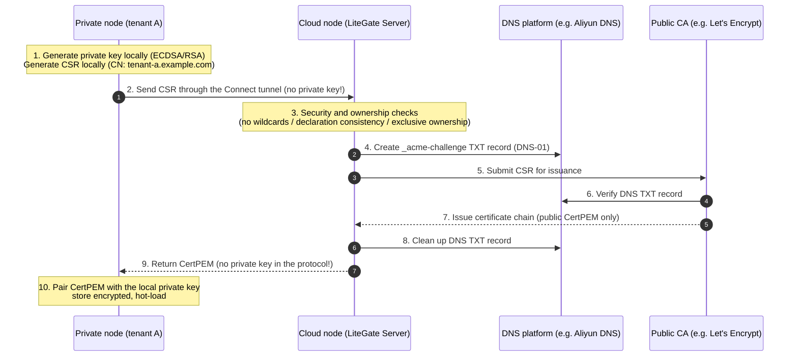

# Connect Delegated Certificate Issuance and End-to-End Private Key Security

LiteGate Connect supports **zero-trust delegated certificate issuance**: a Private node inside an intranet or private cloud generates and keeps its own private key, sends only a certificate signing request (CSR) through the secure Connect tunnel to a Cloud node that holds public DNS permissions, the Cloud completes ACME DNS-01 and obtains a publicly trusted certificate, and returns only the certificate to the Private node.

This provides:
1. **End-to-end TLS termination**: when public clients reach the Cloud, it only forwards ciphertext by SNI (no TLS termination); decryption happens on the Private node.
2. **The private key never leaves**: the Private node's TLS private key is generated locally and is never sent to the Cloud or anywhere else.
3. **No DNS credential exposure**: DNS credentials (Alibaba Cloud, Cloudflare keys, ...) stay on the Cloud; tenant nodes never touch them.
4. **Strict multi-tenant isolation**: wildcard certificates are refused, and ownership is verified before issuance, so tenants can't forge or decrypt each other's traffic.

---

## 1. Scenario and topology

In a typical hybrid cloud that pushes sensitive data (e-commerce orders, customer data) down into private data centers:

```
[Public cloud]
  Cloud applications / MQ consumers
         │
         │ HTTPS request (Host: tenant-a.example.com)
         ▼
  LiteGate Cloud cluster (public entry 443)
  ├── Holds DNS permissions for *.example.com (DNS provider)
  ├── Runs the Connect Server control plane
  └── L4 SNI router (doesn't decrypt TLS; forwards by SNI)
         │
         │ Connect TLS data tunnel (ciphertext)
         ▼
[Private cloud / customer data center]
  LiteGate Private (Connect client)
  ├── Exclusively holds tenant-a's private key (generated and stored locally)
  ├── Terminates TLS
  └── Forwards plaintext to internal systems (JetStream / local API / database)
```

### Control plane and issuance sequence



---

## 2. Private key lifecycle

### 2.1 Generated locally, never leaves
- **Where**: the private key is generated on the Private node by `internal/certmanager` with Go's standard cryptography (ECDSA P-256 by default, or RSA-2048/4096).
- **Protocol constraint**: the Connect control-plane `CSRAckPayload` has **no private key field**. The Cloud can't send private keys, and the Private node never uploads one.
- **In memory**: the private key is used only by the Private process's TLS layer.

### 2.2 Encryption at rest
After receiving the certificate, the Private node stores the certificate and local private key in `certs_dir`. To protect against unauthorized copies, LiteGate supports **AES-256-GCM encryption at rest** for certificates and keys.

Configure `storage_secret` in the Private node's `config.yaml`:
```yaml
auto_cert:
  enabled: true
  storage_secret: "env://AUTOCERT_STORAGE_SECRET"   # random key of at least 32 bytes, injected by reference, never plaintext
  certs_dir: ./certs
```
With this set, every private key (`.key`) and certificate (`.crt`) written to disk is encrypted with authentication, so a stolen disk image doesn't reveal the private key. It protects against disks or backups being copied; a fully compromised host can read process memory and the key source, which this cannot prevent.

### 2.3 Injecting secrets dynamically
`storage_secret` and the Connect `token` can be resolved through LiteGate's unified secret resolver, leaving no plaintext in configuration:

| Mode | Example | Notes |
| :--- | :--- | :--- |
| **Environment variable** | `env://AUTOCERT_STORAGE_SECRET` | Standard container injection |
| **File mount** | `file:///run/secrets/storage_key` | K8s Secret or Docker Swarm volume |
| **Remote HTTPS** | `https://kms.example.com/v1/keys#secret` | Central KMS service |
| **HashiCorp Vault** | `vault://secret/data/litegate#storage_secret` | Enterprise Vault KV engine |

---

## 3. Cloud-side protections

To stop malicious or compromised internal nodes from abusing CSR delegation, the Cloud enforces these checks before issuing:

### ① Parse the CSR and check declaration consistency
An attacker might declare `tenant-a.example.com` in the request (to pass a coarse domain check) but embed `*.example.com` or `admin.example.com` in the CSR itself.
- **Defense**: the Cloud parses `CSRPEM` and extracts `Subject.CommonName` and `DNSNames` (SAN) from the ASN.1 structure.
- **Rule**: the set of domains in the CSR must **exactly equal** the declared `req.Domains`; anything extra, missing or different is rejected (`csr_reject`).

### ② No wildcards
- **Risk**: if tenant A could obtain `*.example.com`, it could decrypt tenant B's traffic or impersonate the whole platform.
- **Defense**: any domain containing `*` is **rejected**, whatever the Peer's allow list says. Delegation **issues only exact-subdomain certificates**.

### ③ Reserved domains and Cloud-local sites
- **Defense**:
  1. **Reserved domains**: the Cloud's own Connect endpoint (such as `connect.example.com`) and `reserved_domains` are platform infrastructure; no Peer may get certificates for them.
  2. **Local sites and overrides**: decided by the Registry's authoritative routing. Cloud-local sites without `connect_override` are never issued to a Peer; sites with `connect_override` that the current Peer has taken over are allowed; Cloud-local wildcard sites don't block subdomains a tenant has registered exactly.

### ④ Peer authorization boundary (`allowed_cert_domains`)
- **Defense**: each Peer has its own `allowed_cert_domains`.
- **Isolation**: routing authorization (`allowed_domains`) and certificate authorization (`allowed_cert_domains`) are separate, so a broad routing wildcard can't be misused as issuance scope.

### ⑤ Exact, dynamic ownership check (no wildcard grabs, no TOCTOU)
- **Risk**: if tenant A registered a `*.example.com` wildcard Site, coarse matching might treat A as the owner of every unassigned subdomain; and ACME issuance takes 1–2 minutes, during which ownership may change.
- **Defense**:
  1. **Exact registration required**: the Cloud looks up the domain in the Registry and requires an exact, not wildcard, registration. **A wildcard registration never proves ownership of a subdomain.**
  2. **Re-check before returning**: after the CA issues and before the certificate is sent, the Cloud **checks exact ownership again**. If the domain was deregistered or transferred meanwhile, the certificate is discarded and never sent.

### ⑥ Abuse and CA quota protection (cooldown + weekly budget)
To stop faulty or malicious clients from rotating keys and exhausting Let's Encrypt quotas (50 new certificates per registered domain per week), the Cloud enforces quotas:
1. **Shared and persistent state**: quota state can be shared across Cloud A/B through **Litemesh KV** (`litegate/connect/csr-quota`), or persisted to a local file without Litemesh; history survives Cloud restarts, so renewals are never mistaken for new issuance.
2. **Per-domain weekly duplicate limit and cooldown**:
   - follows Let's Encrypt's Duplicate Certificate rule (5 per week) with a softer gate;
   - **at most 2 issuances per exact domain within 7 days**, covering reinstalls/lost keys and active/standby with separate keys;
   - **minimum 5-minute interval** between issuances of the same domain. There is currently no exposed quota reset endpoint; wait for the window to expire.
3. **Global weekly budget per registered domain**:
   - new certificates per `eTLD+1` (such as `example.com`) over 7 days; default limit **40 per week** (keeping 10 as platform buffer);
   - **atomic pre-allocation and rollback**: quota is reserved at admission, closing race windows; a failed ACME issuance releases it; once the budget is exhausted, new domains are refused and only renewals pass.

### ⑦ Cryptographic checks on the Private node
Before storing and hot-loading the returned chain, the Private node checks:
1. **Key pair match**: `tls.X509KeyPair` confirms the certificate's public key matches the local private key;
2. **SAN/CN coverage**: `leaf.VerifyHostname` confirms every requested domain is covered;
3. **Validity window**: the current time is between `NotBefore` and `NotAfter`; damaged, mismatched or expired certificates are discarded with an alert.

---

## 4. Production configuration

### 4.1 Cloud (`config.yaml`)

The Cloud opens the public ports, configures a DNS provider (for DNS-01) and runs the Connect Server:

```yaml
# ==============================================================================
# LiteGate Cloud node
# ==============================================================================

# 1. Entrypoints
entrypoints:
  web:
    address: ":80"
  websecure:
    address: ":443"

# 2. Auto cert and DNS provider
auto_cert:
  enabled: true
  email: "ops@example.com"
  ca_provider: "letsencrypt"     # or custom / zerossl
  use_staging: false            # true for first-time debugging
  certs_dir: ./certs

  # DNS provider controlling the main domain (for DNS-01 done on behalf of Peers)
  dns_providers:
    - name: "aliyun-main"
      type: "aliyun"
      enabled: true
      domains:
        - "*.example.com"
        - "example.com"
      config:
        access_key_id: "env://ALIYUN_DNS_AK"
        access_key_secret: "env://ALIYUN_DNS_SK"
        propagation_wait: "60s"
        skip_propagation_check: "true"

# 3. Connect Server
connect:
  server:
    enabled: true
    hostname: connect.example.com  # Connect control-plane domain (reserved automatically)
    path: /_litegate/connect/v1
    state_file: ./data/connect-registry.json

    # Globally reserved domains (no Peer may register them or get certificates)
    reserved_domains:
      - admin.example.com
      - gitea.example.com

    peers:
      # Tenant A
      tenant-a:
        token_file: ./secrets/tenant-a.token
        # Domains this Peer may publish through Connect
        allowed_domains:
          - "tenant-a.example.com"
        # Domains this Peer may request certificates for (exact, least privilege)
        allowed_cert_domains:
          - "tenant-a.example.com"
        max_sites: 50
        max_connections: 2048
        sessions: 2

      # Tenant B
      tenant-b:
        token_file: ./secrets/tenant-b.token
        allowed_domains:
          - "tenant-b.example.com"
        allowed_cert_domains:
          - "tenant-b.example.com"
        max_sites: 50
        max_connections: 2048
        sessions: 2
```

---

### 4.2 Private / internal node (`config.yaml`)

The Private node needs no public DNS credentials; it uses the `connect` DNS provider and its local business Site:

```yaml
# ==============================================================================
# LiteGate Private node for tenant A
# ==============================================================================

# 1. Local entry (TLS is decrypted locally)
entrypoints:
  websecure:
    address: ":8443"  # local HTTPS port

# 2. Auto cert (key point: connect delegation)
auto_cert:
  enabled: true
  storage_secret: "env://PRIVATE_STORAGE_SECRET"  # key for encrypting local private keys at rest
  certs_dir: ./certs
  renew_days: 10                                 # renew automatically 10 days before expiry

  dns_providers:
    # Delegate certificate issuance for this domain to the Cloud
    - name: "cloud-csr-delegate"
      type: "connect"
      enabled: true
      domains:
        - "tenant-a.example.com"

# 3. Connect client
connect:
  client:
    enabled: true
    name: tenant-a
    remote: https://connect.example.com/_litegate/connect/v1
    token_file: ./secrets/connect.token
    publish_sites: true     # publish local Sites to the Cloud automatically
    publish_streams: false
    sessions: 2
    max_connections: 2048
    exclude_domains:
      - connect.example.com

```

The business Site lives in its own site file (`sites/tenant-a.yaml`) on the local `websecure`; its certificate comes from the connect delegation above:

```yaml
# sites/tenant-a.yaml
site: tenant-a.example.com
entrypoints: [websecure]
proxy: http://127.0.0.1:8080   # local internal plaintext service
```

---

## 5. Certificate lifecycle

### 5.1 First start and certificate readiness
1. The Private node starts and finds no certificate for `tenant-a.example.com` in `certs/`;
2. It registers the Site with the Cloud with status `pending_certificate`;
3. The Cloud marks the domain not ready in the Registry; requests reaching the Cloud get a fail-closed error, and no unencrypted data leaks;
4. Meanwhile the Private node starts delegated issuance:
   - generates a private key and CSR locally;
   - sends the CSR to the Cloud, which verifies ownership (the current Peer now owns the domain) and completes DNS-01;
   - returns the certificate when issued;
5. The Private node pairs the certificate with its local key and hot-loads it into the TLS engine;
6. It reports the status change, and the domain becomes `ready` on the Cloud;
7. The whole process is automatic; its duration depends on DNS propagation and the CA, usually a minute or two. Until the certificate is ready the domain stays `pending_certificate` and requests reaching the Cloud are rejected, so allow for this window on first rollout; it is not unconditionally zero-downtime.

### 5.2 Automatic renewal (hot renewal)
- The Private node runs a daily check.
- When the remaining validity drops below `renew_days`, it generates a new CSR and requests renewal through the tunnel.
- The Cloud issues again and returns the new certificate.
- The Private node swaps it in atomically in memory without dropping established long connections.

---

## 6. Capacity planning and CA rate limits

### 6.1 Let's Encrypt quotas
If the platform uses Let's Encrypt, mind these limits:
- **Per registered domain**: at most **50 new certificates per week** per registered domain (such as `example.com`);
- **Renewals don't use the new-certificate quota**: a certificate with exactly the same domain set renewed within validity is a renewal, limited separately (300 per week per registered domain).

### 6.2 Estimating scale

With 90-day Let's Encrypt certificates renewed about every 60 days, 50 new certificates per week per registered domain covers on the order of several hundred separate subdomains per renewal cycle. The tenants you can actually support also depend on how fast new tenants arrive, duplicate issuance from reinstalls or active/standby, and the CA's current published limits. Calculate against your own growth before going live, and don't treat this estimate as a capacity promise. The Cloud's default global weekly budget of 40 leaves the platform a buffer.

### 6.3 When the quota isn't enough

#### Option A: request a rate limit increase from Let's Encrypt
Let's Encrypt offers a rate limit increase request for large SaaS platforms; once approved, the architecture needs no change. How much it rises is up to the CA.

#### Option B: a private CA for internal callers
When all callers are your own services, switch the Cloud's `ca_provider` to an internal private CA (LiteMesh CA, HashiCorp Vault CA, Step-CA):
```yaml
auto_cert:
  ca_provider: "custom"
  acme_url: "https://ca.internal.example.com/acme/directory"
  acme_ca_cert: "/etc/litegate/certs/internal-root-ca.pem"
```
- **Benefit**: no public CA quotas; validity periods set by the private CA;
- **Callers**: only need to trust the internal root CA in their containers/systems.

---

## 7. FAQ and troubleshooting

### Q1: `wildcard domain "..." in CSR is forbidden for multi-tenant isolation`?
- **Cause**: the Private node's `domains` or the CSR contains a wildcard such as `*.example.com`.
- **Fix**: delegation disables wildcard issuance for multi-tenant safety. Configure exact subdomains (such as `tenanta.example.com`) on the Private node.

### Q2: `domain "..." in CSR is not currently owned/registered by peer ... with an exact match`?
- **Cause**: the domain in the CSR hasn't been registered by this Peer in the Cloud's Connect Registry, or another Peer owns it.
- **Fix**: check the Private node's sites: the domain must be on `entrypoints: [websecure]` with `publish_sites: true`. Ownership must be registered in the control plane before issuance is allowed.

### Q3: `peer "..." exceeded CSR rate limit` or `reached maximum concurrent CSR requests`?
- **Cause**: the Peer sent too many CSR requests in a short time and hit abuse protection (1 concurrent request and at most 2 per minute per Peer). Reissuing the same domain within 5 minutes, more than twice in 7 days, or exhausting the registered domain's weekly budget returns `minimum cooldown`, `weekly duplicate certificate limit` or `global weekly certificate quota` respectively.
- **Fix**: check the Private node's logs for frequent restarts or certificate files that can't be written, causing repeated retries. Normally it clears after a minute.

### Q4: Where are certificates stored, and in what format?
- **Location**: the Private node's `auto_cert.certs_dir`.
- **Files**:
  - `tenant-a.example.com.crt`: the certificate chain issued by the CA;
  - `tenant-a.example.com.key`: the locally generated private key (AES-GCM ciphertext when `storage_secret` is set).

## Related docs and code

- [Connect configuration](../09-advanced/connect.md)
- [Certificate issuance methods](certificate-application-guide.md)
- [Connect implementation](../../../../internal/connect)
