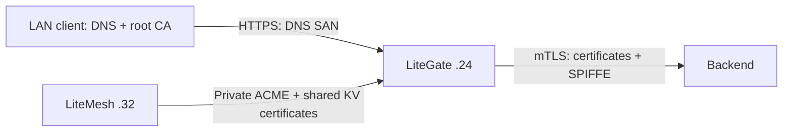

# LAN CAs: centralized LiteMesh issuance, standalone LiteGate and service mTLS

This guide records tests performed on 2026-10-11: LiteGate at `192.168.50.24`, LiteMesh at `192.168.50.32:8787`, and a LAN client on `.32`. Website HTTPS needs a server certificate. Service mTLS additionally needs a caller certificate, workload identity verification and authorization.

## Choose a certificate model

| Scenario | Issuer | Client trust root | Use |
| --- | --- | --- | --- |
| `https://a.dev.test/` | LiteMesh private ACME | LiteMesh Root CA | Central issuance and shared gateway certificates |
| `https://b.dev.test:24443/` | LiteGate Local CA | This instance's Local Root CA | One gateway or development LAN |
| LiteGate / service A → service B | LiteMesh workload CA | LiteMesh Root CA | Mutual authentication, SPIFFE and authorization |

DNS SAN identifies a website hostname; SPIFFE URI SAN identifies a workload. Trusting a CA does not configure DNS or grant permission to call a service. Local CA does not automatically register services, issue SPIFFE identities or enable upstream mTLS.



## Configure client DNS and root trust

Add LAN DNS A records, or use client hosts entries for a small test:

```text
192.168.50.24 a.dev.test b.dev.test
```

Windows hosts is `C:\Windows\System32\drivers\etc\hosts`; Linux/macOS uses `/etc/hosts`. Hosts entries have no port: include a nonstandard port in the URL. Only `.24` and `.32` received the relevant resolution entries in this experiment; other clients still need configuration.

Obtain the root certificate through a trusted administrative channel and compare its fingerprint with the administrator's value. Distribute public root `.crt`/PEM files, never CA private keys. Downloading a certificate does not install trust.

Windows current-user trust:

```powershell
certutil -user -addstore Root .\litemesh-root-ca.crt
certutil -user -addstore Root .\litegate-local-root-ca.crt
```

Install only the root needed for your scenario. Ubuntu/Debian system trust:

```bash
sudo install -m 644 litemesh-root-ca.crt /usr/local/share/ca-certificates/litemesh-lan.crt
sudo update-ca-certificates
```

Substitute the local root for standalone sites. Browsers, containers, Java and independent trust stores may need their own import; restart the browser afterwards. `local_ca_trust: true` affects the LiteGate host only, not every LAN client.

For scoped verification without modifying system trust:

```bash
curl --noproxy '*' --resolve a.dev.test:443:192.168.50.24 \
  --cacert litemesh-root-ca.crt https://a.dev.test/api
curl --noproxy '*' --resolve b.dev.test:24443:192.168.50.24 \
  --cacert litegate-local-root-ca.crt https://b.dev.test:24443/
```

Use `curl.exe` on Windows. `--resolve` preserves the URL hostname, SNI and hostname verification. `-k` disables verification and cannot demonstrate valid CA trust.

## Scenario 1: LiteMesh issues and distributes a.dev.test

LiteGate creates a site private key and CSR, completes HTTP-01 through private ACME, receives a DNS certificate signed by LiteMesh CA, and saves the certificate and encrypted private key in LiteMesh KV. Gateways with matching configuration can restore it. Issuance and KV distribution are separate operations; the CA private key stays off the gateway.

### LiteMesh CA fragment

This belongs to LiteMesh, not LiteGate:

```yaml
ca:
  acme:
    enabled: true
    domain_policies: ["a.dev.test"]
    disable_challenge: false
    allow_private_http01: true
```

Keep domain validation enabled. Private HTTP-01 targets require explicit permission. The CA host must resolve `a.dev.test` to `.24` and reach `.24:80/.well-known/acme-challenge/<token>`. Configure CA-side and client-side DNS separately. HTTP-01 uses port 80; see [RFC 8555 §8.3](https://www.rfc-editor.org/rfc/rfc8555.html#section-8.3).

The ACME directory must have trusted HTTPS transport. The deployed `.32:8787` endpoint is HTTP, so this lab uses an HTTPS proxy on `.24:18444`, preserving Host and `X-Forwarded-Proto: https`. Its certificate is signed by LiteMesh CA for `mtls-echo-demo.default.litemesh`; the gateway resolves that name to `.24`.

The local LiteMesh source supports `http.tls_cert_file` / `http.tls_key_file`, but native HTTPS in the deployed binary was not tested. Do not change an existing HTTP port without migrating its control-plane clients. A stable HTTPS reverse proxy is another deployment option; its public URL, returned ACME URLs and certificate hostname must agree.

### LiteGate global configuration

This is a standalone centralized-HTTPS example; add workload mTLS fields later:

```yaml
entrypoints:
  web:
    address: "192.168.50.24:18090"
  websecure:
    address: "192.168.50.24:443"
    tls: true
sites_dir: ./sites
streams_dir: ./streams
http:
  https_port: 0
tls:
  enabled: false
  certs_dir: ./certs-domain
auto_cert:
  enabled: true
  email: ops@dev.test
  ca_provider: custom
  acme_url: "https://mtls-echo-demo.default.litemesh:18444/acme/directory"
  acme_ca_cert: ./litemesh-root-ca.crt
  default_challenge: http
  certs_dir: ./certs-domain
  renew_days: 30
  storage_secret: "file:///etc/litegate/cert-storage-secret"
litemesh:
  enabled: true
  address: "http://192.168.50.32:8787"
  token: "<API_TOKEN>"
  namespace: default
  roles:
    cert_storage: true
  keys:
    cert_prefix: "litegate/demo-a-dev-test-v3/certs/"
dashboard:
  enabled: false
mcp:
  enabled: false
```

Create `sites`, `streams` and `www`, with `www/index.html`. The storage-secret file holds at least 32 bytes of random encryption-key material and has mode `0600`. Sharing gateways need the same secret, namespace, certificate prefix and ACME URL. `acme_ca_cert` verifies the ACME server; the current certificate-restoration path also uses system roots, so the lab gateway trusts LiteMesh CA in its system store.

`sites/a-dev-test.yaml`:

```yaml
site: a.dev.test
entrypoints: [web, websecure]
https: true
serve:
  root: ./www
  index: index.html
```

Port 80 already belongs to another LiteGate in this lab. Its new site forwards only `a.dev.test` to the issuing instance:

```yaml
site: a.dev.test
https: false
/:
  proxy: 192.168.50.24:18090
```

Without an existing port-80 gateway, let the issuing instance's `web` listen on `:80` directly. An HTTPS-only site is insufficient for HTTP-01.

### Observed LiteMesh compatibility defect

The unmodified challenge response lacks `Link: <authorization-url>;rel="up"`. LiteGate's lego client reads that header and otherwise fails with `authorization[get]: empty URL`. [RFC 8555 §7.1](https://www.rfc-editor.org/rfc/rfc8555.html#section-7.1) describes the challenge-to-authorization `up` relation.

On 2026-10-11, LiteMesh `internal/app/acme.go` was fixed to return the parent authorization `Link` directly, with regression coverage. The fixed binary was deployed to the lab control plane. With proxy compensation removed and fresh local certificate storage and a fresh KV prefix, new issuance succeeded and `https://a.dev.test/api` returned 200. `examples/mtls-demo/acme-proxy.py` now supplies HTTPS transport only; issuance no longer depends on header compensation. The HTTP-only deployment is a separate transport configuration issue.

An unconfigured `auth.security_admin_token` makes intention writes return 503 by design. With user authorization, the experiment configured a dedicated management token and restarted LiteMesh; do not bypass that protection.

## Scenario 2: standalone LiteGate Local CA

This mode needs no LiteMesh, ACME, port-80 validation or public DNS. Tested isolated configuration:

```yaml
entrypoints:
  web:
    address: "192.168.50.24:18092"
  secure:
    address: "192.168.50.24:24443"
    tls: true
sites_dir: ./sites
streams_dir: ./streams
http:
  https_port: 0
auto_cert:
  enabled: false
tls:
  enabled: false
  certs_dir: ./certs
  local_ca: true
  local_ca_domains: ["b.dev.test"]
  local_ca_trust: false
dashboard:
  enabled: false
mcp:
  enabled: false
```

`secure.tls: true` enables TLS on that listener; `tls.enabled: false` disables the legacy global listener switch. Site configuration:

```yaml
site: b.dev.test
entrypoints: [secure]
https: true
serve:
  root: ./www
  index: index.html
```

Startup creates `certs/local_root_ca.crt` and `certs/local_root_ca.key`. The first handshake for an allowed domain creates its leaf certificate. Trust this instance's root and visit `https://b.dev.test:24443/`. Port 24443 isolates this experiment from centralized HTTPS on 443; an ordinary standalone deployment can use 443.

Preserve the CA directory. Restart loads the original root; leaf certificates may change without requiring a new client root import. Independently generated roots on different hosts are unrelated. Local CA is not a multi-node certificate distribution or registration service. Its allow-list restricts normal signing requests, **not an attacker holding a leaked CA private key**.

## Scenario 3: LiteGate / service A to service B mTLS

The tested caller is `spiffe://litemesh.local/ns/default/sa/litegate-mtls-demo`, and the backend is `spiffe://litemesh.local/ns/default/sa/mtls-echo-demo`. Direct service A → B can use the same workload certificate model without browser certificates or Local CA.

### Register and provision the backend

Send this to `PUT /v1/registry`:

```json
{
  "service_id": "litegate-mtls-echo-demo-20261011",
  "name": "mtls-echo-demo",
  "namespace": "default",
  "address": "192.168.50.24",
  "port": 28443,
  "protocol": "http",
  "tags": ["mtls"],
  "meta": {
    "mtls_port": "28443",
    "spiffe_id": "spiffe://litemesh.local/ns/default/sa/mtls-echo-demo"
  },
  "check": {
    "type": "tcp",
    "target": "192.168.50.24:28443",
    "interval": "10s",
    "timeout": "2s"
  }
}
```

Declare `protocol: http` explicitly: a TCP check can otherwise make LiteMesh infer TCP. A TCP check proves port reachability, not mTLS or authorization. `mtls_port` identifies the TLS port and may differ from the ordinary registration port.

Keep the registration response's workload bootstrap token private. Generate the private key on the service host and submit `public_key`, `spiffe_id`, `service_id` and `workload_token` to `/v1/ca/sign`. Identity must match the registered service, namespace and source address. Retrieve the root from `/v1/ca/root`. The lab used administrator signing for static backend PEMs; long-running services should use workload credentials and SDK renewal.

### Require caller certificates on the backend

The Go SDK `github.com/james/litemesh/sdk` provides `WatchCertificateWithWorkloadAuth` for renewal. This fragment assumes its certificate manager and an `x509.CertPool` containing only LiteMesh roots:

```go
tlsConfig := &tls.Config{
    MinVersion:     tls.VersionTLS12,
    GetCertificate: certManager.GetCertificate,
    ClientAuth:     tls.RequireAndVerifyClientCert,
    ClientCAs:      roots,
    VerifyConnection: func(cs tls.ConnectionState) error {
        allowed := "spiffe://litemesh.local/ns/default/sa/litegate-mtls-demo"
        if len(cs.PeerCertificates) == 0 {
            return fmt.Errorf("client certificate required")
        }
        for _, uri := range cs.PeerCertificates[0].URIs {
            if uri.String() == allowed { return nil }
        }
        return fmt.Errorf("client SPIFFE identity not allowed")
    },
}
server := &http.Server{Addr: ":28443", Handler: mux, TLSConfig: tlsConfig}
err := server.ListenAndServeTLS("", "")
```

An HTTPS listener alone does not demand client certificates; `RequireAndVerifyClientCert` does. Check the leaf's URI identity after chain validation, not URIs on CA/intermediate certificates.

### Configure LiteGate as caller

Merge these fields into the centralized example and configure discovery:

```yaml
litemesh:
  enabled: true
  address: "http://192.168.50.32:8787"
  token: "<API_TOKEN>"
  namespace: default
  mtls: true
  spiffe_id: "spiffe://litemesh.local/ns/default/sa/litegate-mtls-demo"
service_discovery:
  catalogs:
    - enabled: true
      provider: litemesh
      url: "http://192.168.50.32:8787"
      token: "<API_TOKEN>"
      namespace: default
```

Preserve `roles.cert_storage` and `keys.cert_prefix`. Alternatively, supply `workload_service_id` and `workload_token` together for signing; configure policy/discovery read permissions separately.

The current gateway certificate manager requires global `litemesh.mtls: true`; a service tag alone does not initialize it. The global switch also forces instances in that discovery source to mTLS. Check this behavior before mixing plaintext and mTLS services. The live test enabled both the switch and tag; it did not prove tag-only initialization.

Site configuration:

```yaml
site: a.dev.test
entrypoints: [web, websecure]
https: true
services:
  echo:
    discovery:
      name: mtls-echo-demo
    timeout: 5s
/api:
  service: echo
/:
  serve:
    root: ./www
    index: index.html
```

Discovery upgrades tagged endpoints to HTTPS, selects `mtls_port` and verifies the backend CA and SPIFFE identity. This experiment found and fixed a LiteGate pool-construction bug that overwrote discovery mTLS, covered by `TestCatalogPoolPreservesDiscoveryMTLS`. Older binaries need that fix.

### Intentions and direct service callers

Write to `PUT /v1/authz/intentions` with the dedicated administrative header `X-Litemesh-Security-Token`:

```json
{
  "source": "spiffe://litemesh.local/ns/default/sa/litegate-mtls-demo",
  "destination": "spiffe://litemesh.local/ns/default/sa/mtls-echo-demo",
  "action": "allow"
}
```

LiteGate maintains intentions and revocations and checks them locally at handshake. No allow rule or an unready policy cache means denial. Its data-plane token needs reads of `/v1/authz/intentions`, `/v1/ca/revocations` and `/v1/events`; do not distribute the administrative token to workloads.

For direct A → B calls, register A, obtain A's workload certificate, and build its client TLS configuration:

```go
cfg, err := litemesh.BuildDynamicTLSConfigWithSPIFFE(
    clientCertManager, rootPEM,
    []string{"spiffe://litemesh.local/ns/default/sa/mtls-echo-demo"},
    x509.ExtKeyUsageServerAuth,
)
// Check err, then assign cfg to http.Transport.TLSClientConfig.
```

This verifies the CA chain and backend URI identity without requiring an IP SAN; authentication is not skipped. B's leaf-identity allow-list must permit A. The TLS helper and static allow-list do **not** automatically enforce intentions or revocations. Custom services needing dynamic policy should maintain `PolicyCache`, check `Ready()`, `IsRevoked(leaf)` and `Authorize(source, destination).Allowed`, and handle established connections after updates. LiteGate already integrates this behavior.

## Verified results and limitations

| Test | Result |
| --- | --- |
| Trusted LiteMesh root → `a.dev.test/api` | 200, backend mTLS succeeds |
| Missing LiteMesh root trust | Chain verification fails |
| Move local a.dev.test cert/key aside and restart | Restored from KV with identical PEM hash, 200 |
| Trusted standalone root → `b.dev.test:24443` | 200 without LiteMesh/ACME |
| Missing root or using LiteMesh root for standalone site | Both fail chain verification |
| Disallowed Local CA domain | TLS rejection |
| Restart standalone gateway | Same root, client still receives 200 |
| Missing/untrusted client certificate at backend | TLS rejection |
| Trusted certificate with wrong client SPIFFE | Backend 403 |
| Intention deny / restored allow | LiteGate 403 / 200 |

Repository evidence is under `artifacts/mtls-demo-20261011/`: `domain-verification.json`, `local-ca-verification.json` and `verification.json`. Public roots are `litemesh-root-ca.crt` and `litegate-local-root-ca.crt`, without private keys. The standalone test script is `examples/mtls-demo/test-local-ca.py`; its remote directory is `.24:/root/litegate-local-ca-demo-20261011`. The centralized/mTLS directory is `.24:/root/litegate-mtls-demo-20261011`.

These manually started test services have no boot-time setup. Renewal is configured/implemented, but this experiment did not wait through a year-long validity period or verify long-term rotation. Static backend PEMs require renewal or SDK management. Preserve correct clocks, validity, root backups and private-key permissions.

## Troubleshooting

Check DNS and port first, then client root trust, DNS SAN and certificate dates. For issuance, check the HTTPS directory, CA-side DNS, port-80 HTTP-01 and challenge responses; `authorization[get]: empty URL` indicates the compatibility problem above. For mTLS, also check the registration protocol, `mtls_port`, both SPIFFE identities, intentions and revocations. HTTP 403 and TLS handshake failure are rejections at different stages.

Allow-lists cannot contain a leaked CA private key. Protect and back up roots/private keys and preserve the certificate-storage encryption key. Do not delete a root CA to fix an ordinary leaf-certificate problem: that would require updating every client trust store.

See [Local CA](local-ca.md), [Auto-Cert](auto-cert.md) and [LiteMesh mTLS](../07-discovery/litemesh-mtls.md).
