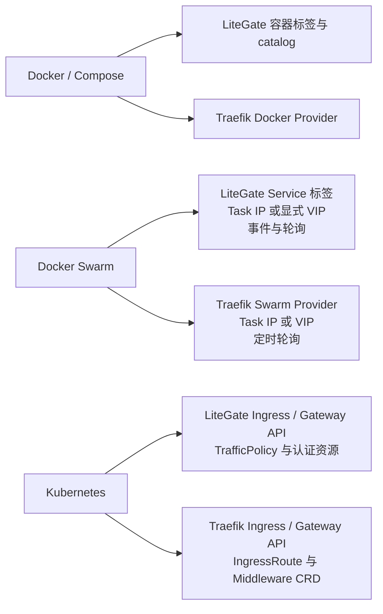

# LiteGate 与 Traefik：Docker、Docker Swarm、Kubernetes 能力对比

评估日期：2026-10-15。**本文根据源码实现和测试代码评估，不以已有产品文档、功能宣传或旧对比文档作为能力依据。**

## 评估范围与读图方式

- **LiteGate**：当前本地工作区，基线提交 `bcc663254dd03c003e9483e62897f52a39d17232`，包含评估时已有的未提交修改和新增代码。结论不能直接套用于该提交对应的已发布二进制。
- **Traefik Proxy 开源版**：固定 `v3.6.0`，提交 `06db5168c0d936a0716cbede56bc2cd332be0d4f`；直接检出上游源码检查。此版本是可复核的比较基线，不代表评估日最新版，不涵盖商业产品和第三方插件。
- **✅**：发现配置入口、转换或发现逻辑及执行路径；代表源码实现存在，不代表所有规范条款、生产负载或真实集群验收通过。
- **△**：支持有明确边界，或需要其他配置入口；请结合单元格说明。
- **—**：在本次固定范围对应入口中没有实现路径；不能推导为整个产品都不能实现该能力。
- 每行的 `[Lx]`、`[Tx]` 对应文末源码索引。测试执行结果单独列出，避免把“测试文件存在”和“本次测试通过”混为一谈。

## 能力对比总览图

| 场景 | LiteGate | Traefik Proxy v3.6.0 | 最关键的实现差异 |
|---|---|---|---|
| Docker / Compose | ✅ 容器发现、标签 HTTP/TCP/UDP、事件与补偿同步 | ✅ 容器发现、标签 HTTP/TCP/UDP、事件同步 | LiteGate 提供命名 catalog 隔离；命名 TCP 标签的 TLS 配置只允许透传。[L1–L4][T1] |
| Docker Swarm | ✅ Service 声明、Task IP、显式 VIP、事件加轮询 | ✅ Service 声明、Task IP、VIP、轮询 | LiteGate 默认 5 秒补偿同步并处理事件；Traefik 默认 15 秒轮询。时间是控制面配置值，不是故障恢复性能测量。[L1][L5][T2] |
| Kubernetes | ✅ Ingress、Gateway API、原生流量策略 | ✅ Ingress、Gateway API、Traefik CRD | LiteGate 实现 Gateway UDPRoute；Traefik 该入口没有 UDPRoute，但可走 IngressRouteUDP。两者 CRD 不兼容。[L6–L11][T3–T5] |



该图表达配置与发现入口，不能用于比较吞吐、延迟或成熟度。

## Docker / Compose 详细对比

| 能力 | LiteGate | Traefik v3.6.0 | 源码依据 |
|---|---|---|---|
| 容器发现与 Compose 服务归组 | ✅ 读取容器；默认使用 Compose project/service 生成发现名称，也允许覆盖 | ✅ 读取容器并构造动态配置，处理 Compose 服务名称 | [L1][T1] |
| 标签驱动 HTTP 路由与服务 | ✅ 自有 `litegate.*` 标签资源编译 | ✅ `traefik.*` 标签解码为 Router / Service / Middleware | [L3][T1] |
| 默认暴露语义 | △ 没有 LiteGate 标签不注册；任意 `litegate.*` 标签可触发注册，显式 `litegate.enable` 优先；不等于只有 enable=true 才会暴露 | △ `ExposedByDefault` 默认 true，可关闭并使用 enable 标签选择 | [L1][T1] |
| 实时变更、断线重连 | ✅ 先订阅再快照、事件处理、重连；默认 60 秒独立容器补偿同步 | ✅ Docker events、快照重建与退避重连 | [L1][T1] |
| 容器健康状态 | ✅ 读取 Health 并处理 healthy/unhealthy 事件 | ✅ 根据容器状态和健康状态筛选/保留空服务，受 AllowEmptyServices 配置影响 | [L1][T1] |
| 指定网络、内部 IP、宿主机映射端口 | ✅ network、internal/external、usehostport，并有回退逻辑 | ✅ network、UseBindPortIP、host 网络等路径 | [L1][T1] |
| Unix / TCP / TLS / SSH / Windows pipe 连接 | ✅ 自有客户端及对应 transport 实现；TLS/SSH 有校验和配置入口 | ✅ Docker 客户端和连接配置；平台相关行为依赖客户端与部署环境 | [L2][T1] |
| 按标签约束筛选 | ✅ constraints 编译后应用到发现对象 | ✅ constraints 筛选 | [L2][T1] |
| 同一进程接多个 Docker 来源 | ✅ 命名 catalogs、稳定来源身份、显式 instance 引用和归属校验 | △ Docker Provider 本身配置一个 Endpoint；不能据此认定支持 LiteGate 式多命名 Docker catalogs | [L2][T1] |
| 命名 TCP / UDP 标签路由 | ✅ 均有解析、编译与发布路径；需显式入口和本地服务引用 | ✅ TCP/UDP 标签路由与服务构建 | [L4][T1] |
| 命名 TCP 标签 TLS 终止 | — 当前校验要求 tls.enabled 与 tls.passthrough 同时开启，即仅允许透传；不能扩展为整个 LiteGate 不支持 TLS 终止 | ✅ TCP Router 支持 TLS 终止与透传 | [L4][T6] |

**判断**：Docker 的主要发现和标签路由能力两者都有实现。LiteGate 的多来源隔离和显式校验值得突出，但不能写成 Traefik 标签语法兼容；两套标签需要分别配置。

## Docker Swarm 详细对比

| 能力 | LiteGate | Traefik v3.6.0 | 源码依据 |
|---|---|---|---|
| Service 级标签作为声明来源 | ✅ 从 Service.Spec.Labels 取声明，与任务端点分离 | ✅ 从 Service 标签构建配置 | [L1][L5][T2] |
| Task IP 直连 | ✅ 获取服务任务与网络地址，筛选可用任务 | ✅ listTasks 获取运行任务及网络地址 | [L1][T2] |
| 使用 Swarm Service VIP | ✅ `litegate.swarm.lbswarm=true` 进入专用解析路径 | ✅ LBSwarm 选择 Service VIP | [L5][T2] |
| VIP 网络选择与失败行为 | △ 必须显式选择网络；拒绝 ingress、dnsrr、歧义 VIP；失败不偷偷改用 Task IP | △ VIP 与网络选择有实现；语义不等同于 LiteGate 的显式网络强校验 | [L5][T2] |
| Service/Task 变更感知 | ✅ Swarm events 加去抖同步，辅以权威轮询；滚动更新/回滚有快速协调路径 | △ 此版本 Swarm Provider 使用 ticker 轮询，不走 Docker Provider 的容器事件逻辑 | [L1][T2] |
| 默认同步间隔 | 5 秒，支持调整 | 15 秒，RefreshSeconds 支持调整 | [L1][T2] |
| manager 连接与模式选择 | △ 显式 swarm mode；可选自动检测且要求连接 manager；自动检测默认不开启 | △ 独立 Swarm Provider 连接集群 API，需要可访问 manager | [L1][L2][T2] |
| overlay 网络及 stack 网络名 | ✅ 网络选择、stack 前缀处理；Task IP 路径存在回退诊断 | ✅ overlay 网络信息和显式网络选择 | [L1][L5][T2] |
| Swarm Published Port / Routing Mesh 作为自动后端模式 | △ 不能按单机 external 模式理解；Swarm 路径会警告该设置，主要按内部任务网络或显式 VIP 解析 | △ 不应把 UseBindPortIP 推广成完整 Swarm Routing Mesh 模式；此处确认的是 Task/VIP 路径 | [L1][T1][T2] |
| 零副本时保留声明与同步一致性 | ✅ ServiceSnapshot 将声明与端点同锁复制，支持无端点声明与后续恢复 | △ 从 Service/Task 构建动态配置；空服务行为受配置影响，未证明等同于 LiteGate 的快照契约 | [L5][T1][T2] |
| HTTP / TCP / UDP 标签 | ✅ 共用标签编译链路与发现来源，TCP TLS 限制同 Docker | ✅ Swarm 数据接入同一动态配置构建器 | [L3][L4][T1][T2] |

**判断**：LiteGate 的 Swarm 不能简单归类为“只有基础发现”：显式 VIP、事件补偿、声明与端点一致性均有代码。其约束也更明确：VIP 需要显式网络，Task IP 需要网关实际可达 overlay 网络。两者均不能仅靠发现成功就证明网络可达。

## Kubernetes 详细对比

| 能力 | LiteGate | Traefik v3.6.0 | 源码依据 |
|---|---|---|---|
| Service / EndpointSlice 发现 | ✅ 原生 List/Watch、分页、resourceVersion、端点条件处理 | ✅ Kubernetes client/informer 与 EndpointSlice 后端发现 | [L6][T3–T5] |
| Ingress / IngressClass | ✅ class/controller 归属、规则转换、TLS Secret、状态更新 | ✅ Ingress Provider、class 筛选、TLS 和状态发布 | [L6][L7][T3] |
| GatewayClass / Gateway / HTTPRoute | ✅ 监听、归属判断、转换及状态发布 | ✅ Gateway Provider 对应发现与转换链路 | [L6–L8][T4] |
| HTTPRoute Host / Path / Header / Query / Method 匹配 | ✅ 有匹配校验及运行时转换 | ✅ HTTPRoute 匹配到动态 Router | [L7][L8][T4] |
| Header 修改、重定向、URL 重写 | ✅ 请求/响应 Header、redirect、rewrite 转换及执行 | ✅ Gateway filter 转中间件 | [L8][T4] |
| HTTPRoute 加权后端 | ✅ 多服务权重处理；含副本数不等和无效后端占比的回归用例 | ✅ HTTPRoute 后端构建与加权服务 | [L6][L8][T4] |
| 标准 HTTPRoute RequestMirror filter | ✅ 解析、授权、转换到镜像执行路径；实现了 percent 字段处理，不据此承诺全部镜像扩展字段 | — loadMiddlewares 的分支不接受 RequestMirror；TraefikService 镜像属于其他入口 | [L8][L10][T4][T5] |
| HTTPRoute 请求/后端超时与会话持久化 | ✅ 有解析、校验、lowering 与执行代码；具体字段受实现校验限制 | △ 本次 Gateway HTTPRoute 源码未发现相应字段的完整转换；其他服务/transport 的 timeout、sticky 不能算标准字段支持 | [L8][L10][T4][T6] |
| GRPCRoute | ✅ Provider、协议校验、转换到代理执行链路 | ✅ grpcroute.go 实现 | [L6][L8][T4] |
| TLSRoute / TCPRoute | ✅ Watch、监听器归属、L4 发布；TLS listener 只接受 Passthrough，HTTPS 用于终止 | △ 需启用 experimentalChannel，才能加载 TCPRoute/TLSRoute | [L6][L9][T4] |
| Gateway API UDPRoute | ✅ Watch、状态、冲突仲裁及 StreamConfigs 输出 | — Gateway Provider 没有 UDPRoute 加载链路；✅ CRD Provider 另有 IngressRouteUDP | [L6][L9][T4][T5] |
| 跨命名空间引用授权 | ✅ ReferenceGrant；后端、镜像、证书等按各自引用路径校验 | ✅ Gateway ReferenceGrant；CRD AllowCrossNamespace 为另一套语义 | [L6][L8][T4][T5] |
| BackendTLSPolicy | ✅ hostname、CA 引用、系统 CA、SAN 校验与后端传输配置链路；有状态与 CA watch | ✅ 策略匹配、hostname、系统 CA 或 ConfigMap CA，生成 ServersTransport；CA 引用只接受 ConfigMap | [L11][T4] |
| ExternalName / 直接使用 ClusterIP | — 当前 Service 模型没有 ExternalName/ClusterIP 地址字段及对应原生后端选择；手写外部 URL 不算原生 Service 类型支持 | ✅ 对应 Provider 有 ExternalName/NativeLB 处理；ExternalName 在部分 Provider 需显式允许 | [L6][T3–T5] |
| 自有治理 CRD | ✅ LiteGateTrafficPolicy：重试、限流、熔断、WAF 开关、CORS、连接限制与认证 | ✅ Middleware、TraefikService、ServersTransport 等，组织方式不同 | [L12][T5][T6] |
| 原生 JWT / JWKS / OIDC | ✅ 策略解析、Secret 认证资源、JWT/JWKS/OIDC 运行时实现 | △ 开源动态 Middleware 没有同名原生 JWT/OIDC 配置；ForwardAuth 可接外部身份服务，插件另算 | [L12][T6] |
| List/Watch 异常与资源恢复 | ✅ 分页、410 重列举、watch 恢复、初始同步与状态代际保护 | ✅ informer/client watch 和动态重建 | [L6][L13][T3][T4] |
| 多副本状态写入 | ✅ Lease 选主和写入范围/对象身份保护；不意味着所有代理流量只经 leader | ✅ Provider 有状态更新路径；此处未验证与 LiteGate 等价的 Lease 写入协调模型 | [L13][T3][T4] |
| 官方 Gateway API 一致性认证 | 本次未执行官方 conformance，不能认定已认证 | 本次未检查认证报告，不能由 SupportedFeatures 声明推导认证结论 | [L14][T4] |

**判断**：LiteGate 已有相当完整的 Kubernetes 控制面实现，在本次基线内可确认其 Gateway UDPRoute、标准镜像 filter 和自有认证策略路径。Traefik 的优势是多套 Kubernetes Provider 及配套 CRD 的可组合配置入口。LiteGate 仍有明确缺口，例如原生 ExternalName/ClusterIP 后端选择；实现范围不能直接换算成稳定性或生态规模。

## 跨场景治理：避免混淆入口与底层能力

| 底层能力 | LiteGate | Traefik v3.6.0 | 使用边界 |
|---|---|---|---|
| 本地限流与 Redis 分布式限流 | ✅ middleware 有本地、自适应和 Redis 分支 | ✅ RateLimit 配置包含 Redis，middleware 有执行实现 | 不能将 Redis 限流写成 LiteGate 独有；LiteGateTrafficPolicy 的限流字段不等于暴露全部底层算法。[L12][L15][T6] |
| 重试、熔断、ForwardAuth | ✅ 相应策略与运行时实现 | ✅ 对应 Middleware | 具体错误条件、表达式、重试方法、字段格式各异，不承诺配置等价。[L10][L12][T6] |
| TCP TLS | ✅ LiteGate 其他入口有 TLS 处理 | ✅ TCP TLS 配置与运行时 | 底层有 TLS 不能消除 LiteGate 命名 TCP 标签只允许透传的限制。[L4][L9][T6] |

不提供主观雷达分数或“完成度百分比”：这些能力没有统一权重，也没有双方相同环境下的吞吐、长稳、故障注入与升级验收数据。

## 源码证据索引

LiteGate 链接指向本工作区文件；Traefik 链接固定到本次检出的提交。以下均为代码或测试，不是产品文档。

| 编号 | 实现与验证入口 |
|---|---|
| L1 | [Docker Provider](../../internal/provider/docker/provider.go)：watchLoop、isLiteGateEnabled、buildEndpoint、Swarm 同步/网络选择；[回归测试](../../internal/provider/docker/review_regression_test.go) |
| L2 | [连接客户端](../../internal/provider/docker/client.go)、[SSH](../../internal/provider/docker/ssh.go)、[配置校验](../../internal/config/docker.go)、[ProviderOptions](../../internal/provider/docker/options.go)、[多来源](../../internal/provider/docker/multi.go)、[来源引用校验](../../internal/loader/docker_source_validation.go) |
| L3 | [标签解析](../../internal/loader/tag_resources.go)、[资源编译](../../internal/loader/tag_resource_compiler.go)、[编译测试](../../internal/loader/tag_resource_compiler_test.go) |
| L4 | [命名 TCP/UDP 资源与 TLS 校验](../../internal/loader/tag_stream_resources.go)、[命名流发布测试](../../internal/loader/named_stream_test.go) |
| L5 | [VIP 解析](../../internal/provider/docker/vip.go)、[VIP 测试](../../internal/provider/docker/vip_test.go)、[ServiceSnapshot](../../internal/provider/docker/snapshot.go)、[所有权测试](../../internal/provider/docker/source_ownership_test.go) |
| L6 | [K8s Provider](../../internal/provider/k8s/provider.go)、[API 客户端](../../internal/provider/k8s/client.go)、[资源模型](../../internal/provider/k8s/types.go)、[Gateway 测试](../../internal/provider/k8s/provider_gateway_test.go) |
| L7 | [Ingress 转换](../../internal/loader/ingress_translator.go)、[HTTP 校验](../../internal/provider/k8s/http_validation.go)、[Gateway 匹配](../../internal/loader/gateway_match.go) |
| L8 | [Gateway 转换与 filter lowering](../../internal/loader/gateway_translator.go)、[后端引用测试](../../internal/provider/k8s/backend_reference_test.go)、[会话策略](../../internal/provider/k8s/session_governance.go) |
| L9 | [listener 协议约束](../../internal/provider/k8s/listener_protocol.go)、[L4 发布](../../internal/loader/stream_loader.go)、[运行时流入口](../../internal/app/stream_entrypoints.go)、[listener 测试](../../internal/provider/k8s/listener_protocol_test.go) |
| L10 | [后端超时](../../internal/action/backend_deadline.go)、[会话保持](../../internal/action/session_persistence.go)、[镜像集成测试](../../internal/action/mirror_k8s_test.go)、[代理执行](../../internal/action/proxy.go) |
| L11 | [BackendTLS 模型](../../internal/provider/k8s/types_gateway.go)、[CA watch](../../internal/provider/k8s/backend_ca_watch.go)、[SAN 校验](../../internal/proxy/backend_san.go)、[后端 TLS 测试](../../internal/provider/k8s/backend_san_test.go)；策略解析与关联见 L6，传输转换见 L8 |
| L12 | [TrafficPolicy 模型](../../internal/provider/k8s/types_policy.go)、[认证策略转换](../../internal/provider/k8s/policy_auth.go)、[认证资源 lowering](../../internal/loader/auth_resource_lowering.go)、[JWT](../../internal/middleware/jwt_verify.go)、[JWKS](../../internal/middleware/jwks.go)、[OIDC](../../internal/auth/oidc.go) |
| L13 | [初始同步](../../internal/provider/k8s/initial_sync.go)、[watch 恢复](../../internal/provider/k8s/watch_recovery.go)、[选主](../../internal/provider/k8s/leader.go)、[选主作用域](../../internal/provider/k8s/leader_scope.go)、[状态代际](../../internal/provider/k8s/status_generation.go)、[状态前置条件](../../internal/provider/k8s/status_precondition.go) |
| L14 | [Gateway supportedFeatures 声明](../../internal/provider/k8s/supported_features.go)；文件本身明确将实现契约与官方逐项报告区分 |
| L15 | [限流执行](../../internal/middleware/ratelimit.go) |
| T1 | [Docker Provider](https://github.com/traefik/traefik/blob/06db5168c0d936a0716cbede56bc2cd332be0d4f/pkg/provider/docker/pdocker.go)、[配置构建](https://github.com/traefik/traefik/blob/06db5168c0d936a0716cbede56bc2cd332be0d4f/pkg/provider/docker/config.go)、[shared](https://github.com/traefik/traefik/blob/06db5168c0d936a0716cbede56bc2cd332be0d4f/pkg/provider/docker/shared.go) |
| T2 | [Swarm Provider：SetDefaults / Provide / listServices / parseService / listTasks](https://github.com/traefik/traefik/blob/06db5168c0d936a0716cbede56bc2cd332be0d4f/pkg/provider/docker/pswarm.go) |
| T3 | [Ingress Provider](https://github.com/traefik/traefik/tree/06db5168c0d936a0716cbede56bc2cd332be0d4f/pkg/provider/kubernetes/ingress) |
| T4 | [Gateway Provider 源码目录](https://github.com/traefik/traefik/tree/06db5168c0d936a0716cbede56bc2cd332be0d4f/pkg/provider/kubernetes/gateway)：kubernetes.go、httproute.go、grpcroute.go、tcproute.go、tlsroute.go、client.go、features.go；其中 httproute.go 的 loadMiddlewares 和 loadServersTransport 可复核 filter 与 CA 边界 |
| T5 | [CRD Provider](https://github.com/traefik/traefik/tree/06db5168c0d936a0716cbede56bc2cd332be0d4f/pkg/provider/kubernetes/crd)：kubernetes.go、kubernetes_http.go、kubernetes_udp.go 及 CRD 类型 |
| T6 | [动态配置模型](https://github.com/traefik/traefik/tree/06db5168c0d936a0716cbede56bc2cd332be0d4f/pkg/config/dynamic)、[中间件执行](https://github.com/traefik/traefik/tree/06db5168c0d936a0716cbede56bc2cd332be0d4f/pkg/middlewares)、[服务执行](https://github.com/traefik/traefik/tree/06db5168c0d936a0716cbede56bc2cd332be0d4f/pkg/server/service) |

## 本次验证记录

源码检查覆盖 LiteGate 的 Provider → Loader → Action/App 关键链路，以及 Traefik 对应 Provider、动态配置和中间件实现。未在本次评估中部署真实 Docker/Swarm/K8s 集群，未执行 Traefik 测试，未执行双方性能基准或官方 conformance。

本地执行（PowerShell，显式指定本机目标平台）：

```powershell
$env:GOOS = 'windows'
$env:GOARCH = 'amd64'
go test ./internal/provider/docker ./internal/provider/k8s ./internal/loader ./internal/action ./internal/app
```

结果：五个包全部通过；Docker/K8s Provider 返回缓存通过，Loader 16.362 秒、Action 21.407 秒、App 38.849 秒。首轮默认环境执行曾出现 `%1 is not a valid Win32 application`，显式指定上述目标平台后重跑通过；首轮不计为测试通过。该结果是单元/包级测试证据，不替代真实集群验收。

文档检查：53 个本地源码链接全部存在，Markdown 无尾随空格，目录索引已添加。
