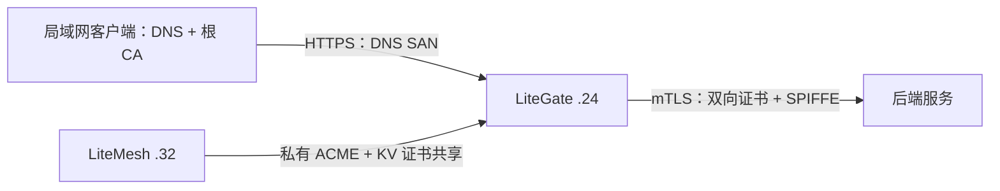

# 局域网 CA：LiteMesh 集中签发、LiteGate 单机签发与服务间 mTLS

本指南基于 2026-10-11 在局域网的实际测试。LiteGate 位于 `192.168.50.24`，LiteMesh 位于 `192.168.50.32:8787`，请求客户端为 `.32`。浏览器访问内网站点需要服务器证书；服务之间使用 mTLS 时，还需要调用方的客户端证书、身份校验和访问策略。

## 选择方式

| 场景 | 签发方 | 客户端信任的根 CA | 适用范围 |
| --- | --- | --- | --- |
| `https://a.dev.test/` | LiteMesh 私有 ACME | LiteMesh Root CA | 集中管理、多网关共享证书 |
| `https://b.dev.test:24443/` | LiteGate Local CA | 此单机的 Local Root CA | 单网关、开发或小型内网 |
| LiteGate / 服务 A → 服务 B | LiteMesh 工作负载 CA | LiteMesh Root CA | 双向认证、SPIFFE 身份与授权 |

三者不能混用概念：DNS SAN 证明服务器对应哪个网站域名；SPIFFE URI SAN 证明工作负载身份。信任 CA 不会自动配置 DNS，也不会自动授予服务调用权限。LiteGate Local CA 不会自动注册服务、签发 SPIFFE 身份或开启后端 mTLS。



## 客户端准备：解析域名并信任正确的 CA

内网 DNS 添加以下 A 记录；小规模验证也可以在客户端 hosts 添加：

```text
192.168.50.24 a.dev.test b.dev.test
```

Windows hosts 位于 `C:\Windows\System32\drivers\etc\hosts`；Linux/macOS 为 `/etc/hosts`。hosts 不包含端口，非标准端口要写在访问 URL 中。实际实验只给 `.24`、`.32` 配置了相关解析，其他客户端仍需自行配置。

从可信管理渠道取得根 CA，核对管理员提供的证书指纹。只分发 `.crt`/根证书 PEM，不能分发 CA 私钥。下载文件并不等于已安装信任。

Windows 当前用户信任库：

```powershell
certutil -user -addstore Root .\litemesh-root-ca.crt
certutil -user -addstore Root .\litegate-local-root-ca.crt
```

需要访问哪套 CA 的站点，就安装哪套；无需为单一场景安装两套。Ubuntu/Debian 系统信任库：

```bash
sudo install -m 644 litemesh-root-ca.crt /usr/local/share/ca-certificates/litemesh-lan.crt
sudo update-ca-certificates
```

使用单机 CA 时替换为对应根证书。浏览器、容器、Java 或独立证书库可能还需要单独导入；重启浏览器后再验证。`local_ca_trust: true` 只影响运行 LiteGate 的主机，不会把 CA 自动装到所有局域网客户端。

也可以不修改系统信任库，先做一次显式 CA 校验：

```bash
curl --noproxy '*' --resolve a.dev.test:443:192.168.50.24 \
  --cacert litemesh-root-ca.crt https://a.dev.test/api
curl --noproxy '*' --resolve b.dev.test:24443:192.168.50.24 \
  --cacert litegate-local-root-ca.crt https://b.dev.test:24443/
```

Windows 使用 `curl.exe`。`--resolve` 保留 URL 域名、SNI 和主机名校验；`-k` 会跳过校验，不能用它证明 CA 信任有效。

## 场景一：LiteMesh 签发并共享 a.dev.test 证书

流程是：LiteGate 生成站点私钥和 CSR，通过 LiteMesh 私有 ACME 完成 HTTP-01 验证，LiteMesh CA 签发 DNS 证书，LiteGate 将证书及加密私钥保存到 LiteMesh KV，其他配置一致的网关可以恢复使用。CA 签发与 KV 分发是两个步骤；不需要把 CA 私钥复制到网关。

### LiteMesh CA 配置片段

以下是 LiteMesh 的配置，不是 LiteGate 的配置：

```yaml
ca:
  acme:
    enabled: true
    domain_policies: ["a.dev.test"]
    disable_challenge: false
    allow_private_http01: true
```

保持域名验证开启。内网 HTTP-01 需要允许私网验证目标；LiteMesh 主机必须能把 `a.dev.test` 解析到 `.24`，并访问 `.24:80/.well-known/acme-challenge/<token>`。这与客户端 DNS 是分别配置的。HTTP-01 使用端口 80，见 [RFC 8555 §8.3](https://www.rfc-editor.org/rfc/rfc8555.html#section-8.3)。

ACME directory 必须通过可信 HTTPS 提供。当前测试部署的 `.32:8787` 是 HTTP；我们用 `.24:18444` 的实验 HTTPS 转发入口，转发到 LiteMesh，并保留 Host 和 `X-Forwarded-Proto: https`。入口证书由 LiteMesh CA 签发，DNS 名为 `mtls-echo-demo.default.litemesh`。网关需要将这个名字解析到 `.24`。

本地 LiteMesh 源码已有 `http.tls_cert_file` / `http.tls_key_file` 配置，但本次没有验证部署二进制的原生 HTTPS；不要直接改变现有 HTTP 端口，导致其他控制面客户端失联。正式使用可部署稳定的 HTTPS 反向代理，入口 URL、返回的 ACME URL 和证书域名应一致。

### LiteGate 全局配置

以下为集中 HTTPS 的独立配置示例；后端 mTLS 在后文追加：

```yaml
entrypoints:
  web:
    address: "192.168.50.24:18090"
  websecure:
    address: "192.168.50.24:443"
    tls: true
sites_dir: ./sites
streams_dir: ./streams
http:
  https_port: 0
tls:
  enabled: false
  certs_dir: ./certs-domain
auto_cert:
  enabled: true
  email: ops@dev.test
  ca_provider: custom
  acme_url: "https://mtls-echo-demo.default.litemesh:18444/acme/directory"
  acme_ca_cert: ./litemesh-root-ca.crt
  default_challenge: http
  certs_dir: ./certs-domain
  renew_days: 30
  storage_secret: "file:///etc/litegate/cert-storage-secret"
litemesh:
  enabled: true
  address: "http://192.168.50.32:8787"
  token: "<API_TOKEN>"
  namespace: default
  roles:
    cert_storage: true
  keys:
    cert_prefix: "litegate/demo-a-dev-test-v3/certs/"
dashboard:
  enabled: false
mcp:
  enabled: false
```

创建 `sites`、`streams` 和 `www` 目录，并放置 `www/index.html`。密钥文件包含至少 32 字节的随机存储加密密钥，权限设为 `0600`；共享证书的网关应使用相同密钥、namespace、证书前缀和 ACME URL。`acme_ca_cert` 用于校验 ACME 服务器；当前 LiteGate 恢复已有证书时还会使用系统根信任库，因此本次也在 `.24` 安装了 LiteMesh 根 CA。

站点配置 `sites/a-dev-test.yaml`：

```yaml
site: a.dev.test
entrypoints: [web, websecure]
https: true
serve:
  root: ./www
  index: index.html
```

测试机器的端口 80 已有另一 LiteGate。该网关新增仅匹配 `a.dev.test` 的站点，将请求转给测试实例，保证 HTTP-01 到达持有 challenge token 的实例：

```yaml
site: a.dev.test
https: false
/:
  proxy: 192.168.50.24:18090
```

没有现有端口 80 网关时，可以让签发实例的 `web` 直接监听 `:80`，不需要这层转发。仅在 HTTPS 上暴露站点不足以完成 HTTP-01。

### 本次发现的 LiteMesh 兼容问题

未补偿的 challenge 响应缺少 `Link: <authorization-url>;rel="up"`。LiteGate 使用的 lego 客户端从该响应头读取授权 URL，因此报 `authorization[get]: empty URL`。[RFC 8555 §7.1](https://www.rfc-editor.org/rfc/rfc8555.html#section-7.1)说明 challenge 到 authorization 的 `up` 关系。

2026-10-11 已在 LiteMesh `internal/app/acme.go` 修复：challenge 响应直接返回父 authorization 的 `Link`，并加入回归测试。修复版已部署到测试控制面；移除代理补偿、使用全新的本地证书目录和 KV 前缀后，重新签发成功，`https://a.dev.test/api` 返回 200。`examples/mtls-demo/acme-proxy.py` 现在仅提供 HTTPS 转发，签发不再依赖响应头补偿。HTTP 控制面缺少 HTTPS 配置是部署问题，与上述兼容缺陷分开处理。

`auth.security_admin_token` 未配置导致 intention 写入返回 503 则是预期的管理保护；本次经授权配置独立管理令牌并重启了 LiteMesh，不应绕过该保护。

## 场景二：LiteGate 单机 Local CA

不依赖 LiteMesh，不需要 ACME、80 端口验证或公网 DNS。以下是已测试的独立实例配置：

```yaml
entrypoints:
  web:
    address: "192.168.50.24:18092"
  secure:
    address: "192.168.50.24:24443"
    tls: true
sites_dir: ./sites
streams_dir: ./streams
http:
  https_port: 0
auto_cert:
  enabled: false
tls:
  enabled: false
  certs_dir: ./certs
  local_ca: true
  local_ca_domains: ["b.dev.test"]
  local_ca_trust: false
dashboard:
  enabled: false
mcp:
  enabled: false
```

显式 `secure.tls: true` 启用该监听器的 TLS，`tls.enabled: false` 关闭的是传统全局监听开关。站点 `sites/b-dev-test.yaml`：

```yaml
site: b.dev.test
entrypoints: [secure]
https: true
serve:
  root: ./www
  index: index.html
```

启动后生成 `certs/local_root_ca.crt` 和 `certs/local_root_ca.key`。允许域名首次握手时按需签发叶子证书；客户端安装此实例的根 CA 后访问 `https://b.dev.test:24443/`。使用 24443 是为了与集中 CA 测试的 443 隔离，正常单机也可以监听 443。

保留整个 CA 目录：重启会加载原根 CA，叶子证书可能重新生成，但客户端不需要重新安装根证书。不同主机独立生成的 Local CA 互不信任；本功能不是证书注册或多节点分发服务。白名单限制正常运行时的签发请求，**不能限制已经泄露的 CA 私钥**；不要把根私钥发给客户端。

## 场景三：LiteGate / 服务 A 与服务 B 之间的 mTLS

以下沿用已测试的身份：调用方 `spiffe://litemesh.local/ns/default/sa/litegate-mtls-demo`，后端 `spiffe://litemesh.local/ns/default/sa/mtls-echo-demo`。直接的服务 A → B 可以使用同一套工作负载证书机制，不需要浏览器证书或 Local CA。

### 后端注册、身份与签发

使用 `PUT /v1/registry` 注册后端，例如：

```json
{
  "service_id": "litegate-mtls-echo-demo-20261011",
  "name": "mtls-echo-demo",
  "namespace": "default",
  "address": "192.168.50.24",
  "port": 28443,
  "protocol": "http",
  "tags": ["mtls"],
  "meta": {
    "mtls_port": "28443",
    "spiffe_id": "spiffe://litemesh.local/ns/default/sa/mtls-echo-demo"
  },
  "check": {
    "type": "tcp",
    "target": "192.168.50.24:28443",
    "interval": "10s",
    "timeout": "2s"
  }
}
```

这里 `protocol: http` 是显式声明业务协议；如果省略，TCP 健康检查可能让 LiteMesh 推断为 TCP。TCP 检查只说明端口可达，不证明证书、身份或授权通过。`mtls_port` 是 TLS 端口，也可以与普通业务注册端口不同。

注册响应会给出工作负载 bootstrap token，妥善保存，不写入公开配置。服务本机生成私钥，通过 `/v1/ca/sign` 提交 `public_key`、`spiffe_id`、`service_id`、`workload_token`；身份必须匹配注册的服务名、namespace 和来源地址。根证书来自 `/v1/ca/root`。实验由管理员令牌签发静态后端证书；长期部署应使用工作负载凭据和 SDK 自动续期。

### 后端必须要求客户端证书

Go SDK `github.com/james/litemesh/sdk` 可以通过 `WatchCertificateWithWorkloadAuth` 自动续期。以下为 TLS 配置片段，`certManager` 是该方法返回的管理器，`roots` 是只装入 LiteMesh 根证书的 `x509.CertPool`：

```go
tlsConfig := &tls.Config{
    MinVersion:     tls.VersionTLS12,
    GetCertificate: certManager.GetCertificate,
    ClientAuth:     tls.RequireAndVerifyClientCert,
    ClientCAs:      roots,
    VerifyConnection: func(cs tls.ConnectionState) error {
        allowed := "spiffe://litemesh.local/ns/default/sa/litegate-mtls-demo"
        if len(cs.PeerCertificates) == 0 {
            return fmt.Errorf("client certificate required")
        }
        for _, uri := range cs.PeerCertificates[0].URIs {
            if uri.String() == allowed { return nil }
        }
        return fmt.Errorf("client SPIFFE identity not allowed")
    },
}
server := &http.Server{Addr: ":28443", Handler: mux, TLSConfig: tlsConfig}
err := server.ListenAndServeTLS("", "")
```

HTTPS 监听本身不会要求客户端证书；关键是 `RequireAndVerifyClientCert`。身份检查只看叶子证书，不应把 CA/中间证书的 URI 当成调用方身份。根 CA 校验通过后，再限制允许的 SPIFFE ID。

### LiteGate 调用方配置

在集中 HTTPS 示例的 `litemesh` 块追加以下字段，并配置发现 catalog：

```yaml
litemesh:
  enabled: true
  address: "http://192.168.50.32:8787"
  token: "<API_TOKEN>"
  namespace: default
  mtls: true
  spiffe_id: "spiffe://litemesh.local/ns/default/sa/litegate-mtls-demo"
service_discovery:
  catalogs:
    - enabled: true
      provider: litemesh
      url: "http://192.168.50.32:8787"
      token: "<API_TOKEN>"
      namespace: default
```

合并字段，不要覆盖掉已配置的 `roles.cert_storage`、`keys.cert_prefix`。也可以用 `workload_service_id` 与 `workload_token` 替代签发所需的管理员凭据，二者必须一起提供；控制面策略/发现读取所需令牌权限另行配置。

当前实现需要全局 `litemesh.mtls: true` 初始化网关证书管理器；实例 `mtls` 标签本身不能替代这一步。而全局开关也会强制该发现源的实例使用 mTLS，混用明文和 mTLS 后端前应检查这一行为。本次实测为全局开关和标签同时开启，没有声称完成了仅靠标签初始化的验证。

站点使用发现服务：

```yaml
site: a.dev.test
entrypoints: [web, websecure]
https: true
services:
  echo:
    discovery:
      name: mtls-echo-demo
    timeout: 5s
/api:
  service: echo
/:
  serve:
    root: ./www
    index: index.html
```

发现层根据标签切到 HTTPS，选择 `mtls_port`，并验证后端 CA 和预期 SPIFFE 身份。本次发现服务池构建时会覆盖发现层的 mTLS 标记，已在 LiteGate 修复，并加入 `TestCatalogPoolPreservesDiscoveryMTLS`；旧二进制需要更新。

### 允许规则与服务 A 直接调用

使用专用管理令牌向 `PUT /v1/authz/intentions` 写入以下规则，请求头为 `X-Litemesh-Security-Token`：

```json
{
  "source": "spiffe://litemesh.local/ns/default/sa/litegate-mtls-demo",
  "destination": "spiffe://litemesh.local/ns/default/sa/mtls-echo-demo",
  "action": "allow"
}
```

LiteGate 拉取 intentions、撤销列表，并在本地握手校验中执行；无允许规则或策略未就绪时拒绝。数据面令牌需要读取 `/v1/authz/intentions`、`/v1/ca/revocations` 和 `/v1/events`，不应把专用管理令牌发给普通服务。

服务 A 直接调用 B 时，也应注册 A、取得 A 的工作负载证书，并配置客户端：

```go
cfg, err := litemesh.BuildDynamicTLSConfigWithSPIFFE(
    clientCertManager, rootPEM,
    []string{"spiffe://litemesh.local/ns/default/sa/mtls-echo-demo"},
    x509.ExtKeyUsageServerAuth,
)
// 检查 err 后，将 cfg 交给 http.Transport.TLSClientConfig。
```

该 SDK 配置验证 CA 链和后端 URI 身份，允许证书不含 IP SAN；它不是跳过认证。服务 B 则把允许的叶子 URI 改成 A 的身份。SDK TLS 帮助函数和简单白名单**不会自动执行 intention 或撤销策略**；自建服务若要使用动态策略，应维护 `PolicyCache`，检查 `Ready()`、`IsRevoked(leaf)` 和 `Authorize(source, destination).Allowed`，并在策略变化时处理旧连接。LiteGate 已集成这部分。

## 实测结果与复验

| 测试 | 结果 |
| --- | --- |
| 客户端信任 LiteMesh CA → `a.dev.test/api` | 200，后端 mTLS 成功 |
| 客户端不信任 LiteMesh CA | 证书链校验失败 |
| 移走 a.dev.test 本地证书，重启网关 | 从 KV 恢复，PEM 哈希一致，200 |
| 客户端信任 Local CA → `b.dev.test:24443` | 200，无 LiteMesh/ACME 依赖 |
| 单机站点不带 CA / 使用 LiteMesh CA | 都被证书链校验拒绝 |
| Local CA 请求未授权域名 | TLS 拒绝 |
| 重启单机实例 | 根 CA 不变，客户端继续返回 200 |
| 直连后端不带客户端证书 / 带非可信证书 | TLS 拒绝 |
| 同 CA 签发但客户端 SPIFFE 不符 | 后端 403 |
| 测试 intention 改为 deny / 恢复 allow | LiteGate 403 / 200 |

记录位于仓库的 `artifacts/mtls-demo-20261011/`：`domain-verification.json`、`local-ca-verification.json`、`verification.json`。可下载的两套根 CA 为 `litemesh-root-ca.crt`、`litegate-local-root-ca.crt`；不含私钥。单机实验脚本为 `examples/mtls-demo/test-local-ca.py`，远程目录为 `.24:/root/litegate-local-ca-demo-20261011`。原集中/mTLS 实验目录为 `.24:/root/litegate-mtls-demo-20261011`。

这些是手动启动的测试服务，没有配置开机启动。续期和自动轮换功能虽已配置/有实现，本次没有等待一年有效期或完成长期轮换测试；静态后端 PEM 需要自行续期或改为 SDK 管理。客户端系统时间、证书有效期、根 CA 备份与私钥权限都应保持正确。

## 排查顺序

先确认域名解析到正确主机及端口，再检查客户端根 CA、证书 DNS SAN 和有效期。ACME 失败时检查 HTTPS directory、HTTP-01 端口 80、CA 主机解析及 challenge 响应；`authorization[get]: empty URL` 对应上述兼容问题。服务间请求还要检查注册协议、`mtls_port`、双方 SPIFFE、允许规则和撤销状态；HTTP 403 与 TLS 握手失败是不同阶段的拒绝。

域名白名单不能防御 CA 私钥泄露；备份根 CA 和私钥并限制访问，维护证书分发加密密钥。不要删除根 CA 来处理普通叶子证书问题，否则所有客户端都需要更新信任。

参见：[Local CA](local-ca.md)、[自动证书](auto-cert.md)、[LiteMesh mTLS 接入](../07-discovery/litemesh-mtls.md)。
